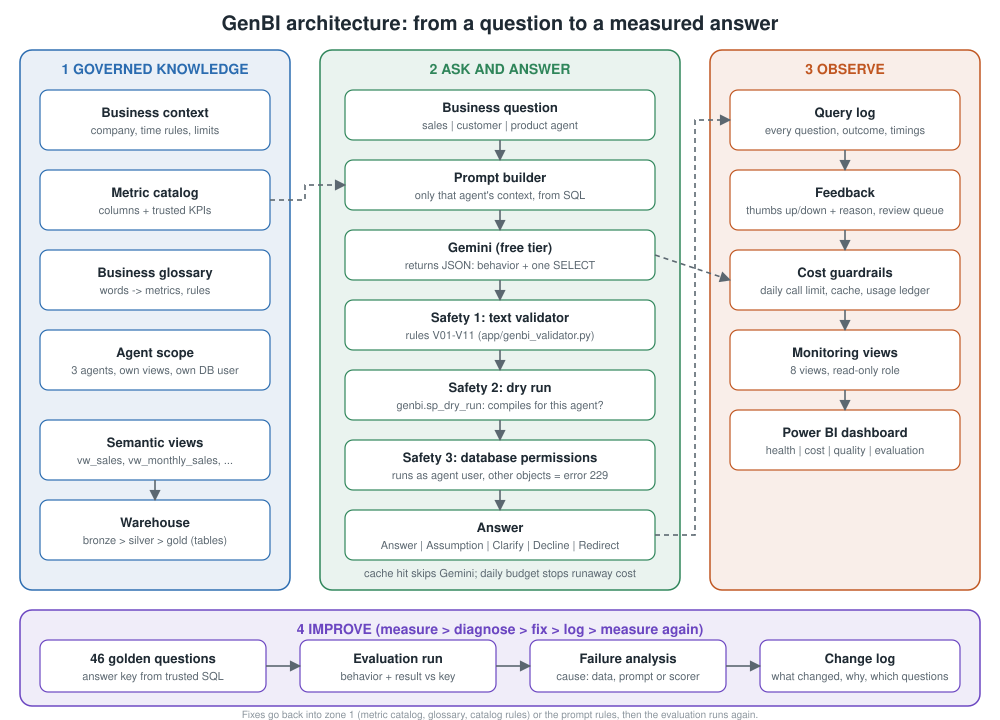

# GenBI: governed natural-language BI on SQL Server


Ask a business question in plain English and get a checked SQL answer, then measure how often the AI is right.
Built with SQL Server, Python (Streamlit), Google Gemini (free tier) and Power BI.

## 1. What it is

A warehouse (bronze / silver / gold) with a semantic layer, and an AI assistant that can only use that layer.
The AI's knowledge (metric definitions, business words, scope) lives in SQL Server tables, not in the prompt text.
Every answer passes three safety layers, is logged, can be rated, and is tested against 46 golden questions.

## 2. How it works



Each stage in detail (objects, files, tests, design decisions): [docs/architecture.md](docs/architecture.md).

The same flow in text:

```
question -> agent (sales | customer | product)
         -> prompt built from SQL tables: context, metric catalog, glossary, the agent's own views
         -> Gemini returns JSON: behavior (Answer | Answer with stated assumption | Clarify | Decline | Redirect) + one SELECT
         -> safety 1: text validator, rules V01-V11        (app/genbi_validator.py)
         -> safety 2: genbi.sp_dry_run                      (does it compile for this agent?)
         -> safety 3: runs as a database user that can read only that agent's views (error 229 otherwise)
         -> answer, log, thumbs up/down  ->  Power BI monitoring
```

## 3. Folder layout

```
sql/build/       the 24 build files, in the order you run them (see sql/RUN_ORDER.md)
sql/tests/       one test file per step; each prints a PASS / FAIL table
sql/analysis/    exploratory analysis and report queries (not needed to rebuild)
sql/ops/         commands for day-to-day use (limits, feedback review, results)
tools/           check_sql.py: static check of the SQL files (object order, quotes, BEGIN/END)
run_all.ps1      optional: runs every build file in order and stops at the first error
app/             genbi_app.py (Streamlit), genbi_validator.py, genbi_eval.py
powerbi/         build guide for the 4-page monitoring dashboard
tableau/         the same dashboard built in Tableau
docs/            architecture.svg, architecture.md (stage by stage), case_study.md, problems_and_fixes.md, commands.md, screenshots/
data/            where the source CSV files go (not committed)
```

## 4. Requirements

- SQL Server (Developer or Express) and SSMS; ODBC Driver 17 or 18; `sqlcmd` (optional)
- Python 3.10+ and the packages in `requirements.txt`
- A free Gemini API key; Power BI Desktop (optional)

## 5. Setup and run

Every command is in [docs/commands.md](docs/commands.md). In short:

1. `pip install -r requirements.txt`
2. Set `GENBI_CONN` and `GEMINI_API_KEY` as environment variables (never put them in code).
3. Edit the data folder path in `sql/build/03_load_bronze.sql`.
4. Run the files in `sql/build/` in number order (`.\run_all.ps1 -Server "<server>"` does it for you).
5. `cd app` then `streamlit run genbi_app.py`

Step 01 drops an existing `DataWarehouse` database. Do not run it on data you want to keep.

## 6. Tests

- **SQL:** each build step has a test file in `sql/tests/` (`t11_...` tests step 11). It prints a PASS / FAIL table and one summary line, so you never compare numbers by hand.
  - **RULE** must always pass. **SEED** is true right after that step and a later step may change it on purpose. **DATA** depends on the files you loaded; a mismatch shows as `DIFF` and is not an error.
  - When a RULE fails, the file ends with a `FAILED RULE TEST` table and an error, so `run_all.ps1 -Tests` stops there.
  - Re-run only the tests later with `.\run_all.ps1 -Server "<server>" -OnlyTests`.
  - Step 09 (read-only login) is optional; its test `t09` needs it. Tests that insert rows (`test_agent`, `TEST`) remove them again.
- **Python (no database, no AI):** `python genbi_validator.py` (33/33), `python genbi_eval.py --selftest` (35/35).
- **AI quality:** `python genbi_eval.py --label <name> --fresh` runs the 46 golden questions.
  A question passes when the AI chose the right behavior **and** the result matches the stored answer key.
- **Test copy:** to try the build without touching your database, replace `DataWarehouse` with `DataWarehouse_test` in the SQL files and in `GENBI_CONN`.

## 7. Results

| Run | Label | Score |
|---|---|---|
| 2 | baseline | 82.61% |
| 3 | baseline-v2 | 86.96% |
| 4 | after improvement cycle 1 | 93.48% |
| 6 | final, fresh answers | **95.65%** (44 of 46) |

- Run-to-run variation is about two questions, so read the result as roughly 93-96%.
- Run 5 (100%) is excluded: 29 of its 46 answers came from the cache.
- Run 7 re-tested only the customer agent after the last fix: 16 of 16. It is not a full run.
- Known limitation: #12 ("What is the sales growth?") sometimes leaves out a column.

## 8. Improvement loop

Each failure was traced to a cause, fixed in the data layer (metric, glossary, catalog) or the prompt, logged in
`genbi.change_log` against the questions it should affect, and re-measured. `genbi.vw_change_effect` shows whether each change
fixed a question or broke one. All problems and fixes are listed in [docs/problems_and_fixes.md](docs/problems_and_fixes.md).

## 9. Power BI

Four pages: health, usage and cost, quality and safety, evaluation and improvement. Build steps and DAX measures are in
`powerbi/powerbi_build_guide.md`. The `.pbix` is not committed because it contains the questions people typed.

## 10. Data

Source files: CRM (`cust_info`, `prd_info`, `sales_details`) and ERP (`LOC_A101`, `CUST_AZ12`, `PX_CAT_G1V2`).

The data comes from the free "SQL Ultimate Course" materials by **Data With Baraa** (YouTube):
https://academy.datawithbaraa.com/l/digital_download/930511/sql-course-materials

The creator's terms: the materials are for learning and personal use only; commercial use, redistribution
or resale of the files is not permitted; public work should credit "Data With Baraa". For that reason the data
files are **not included** in this repo. Download them from the link above and see [data/README.md](data/README.md).

Credit: Data With Baraa. The bronze, silver and gold warehouse follows his course. The semantic layer, governance
tables, agents, safety layers, evaluation, tests and the Streamlit app are my own additions.

## 11. Case study

A one-page write-up of the problem, the method and the results: [docs/case_study.md](docs/case_study.md).

## 12. Limits

46 test questions, one data set, AI answers vary between runs, and the answer key was written by hand so it can be wrong too.
The change log stores the author's run numbers (3, 4, 6); on a fresh database they match only your own history.
