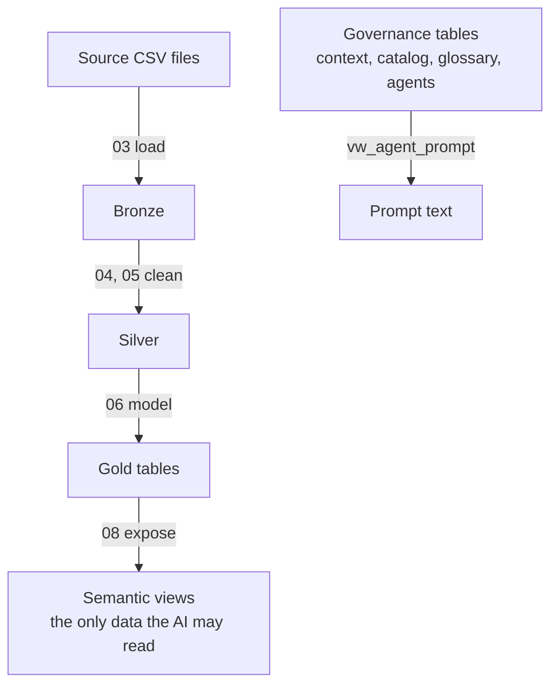
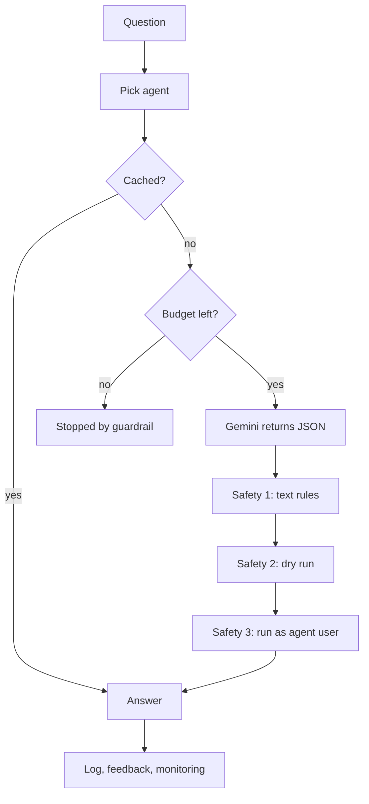
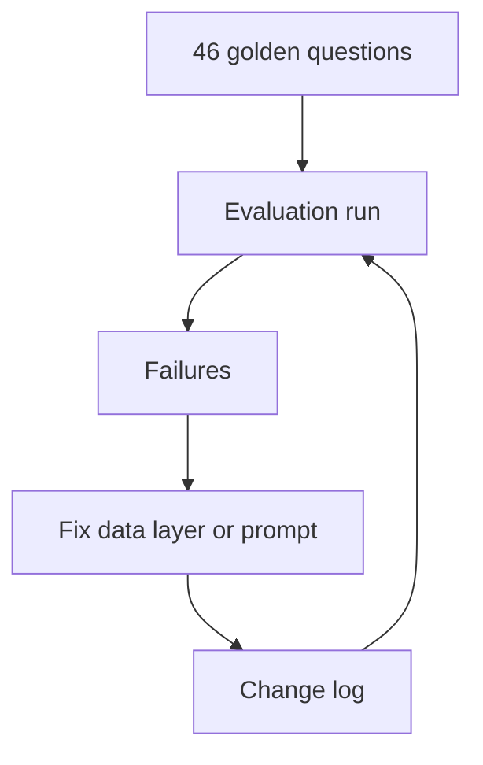

# Architecture

This page explains the system stage by stage. The picture is in [architecture.svg](architecture.svg).
Every name below is a real object in `sql/build/` or `app/`.

**Contents:** [Overview](#overview) | [1 Warehouse](#1-warehouse) | [2 Governed knowledge](#2-governed-knowledge) | [3 Ask and answer](#3-ask-and-answer) | [4 Observe](#4-observe) | [5 Evaluate and improve](#5-evaluate-and-improve) | [6 Testing](#6-testing) | [Security](#security)

---

## Overview

### The six stages

| # | Stage | What it does | SQL steps | Main tests |
|---|---|---|---|---|
| 1 | Warehouse | Raw files become clean tables and five semantic views | 01-08 | t03, t05-t08 |
| 2 | Governed knowledge | Definitions, business words, agents and permissions live in tables | 10-13, 24 | t10-t13, t24 |
| 3 | Ask and answer | A question becomes a checked, logged SQL answer | 16, app | t16 |
| 4 | Observe | Cost, usage, feedback and dashboard views | 17-19, 21 | t17-t19, t21 |
| 5 | Evaluate and improve | 46 golden questions, a score, a change log | 14, 15, 20, 22 | t14, t15, t20, t22 |
| 6 | Testing | Tests at every level, plus CI on GitHub | all | all |

### Data flow

### Question flow

### Improvement loop

---

## 1. Warehouse

**Purpose:** turn raw files into a few trusted views.
**Steps:** 01-08. **Run:** `sql/RUN_ORDER.md`.

| Layer | Objects | Built by | Tested by |
|---|---|---|---|
| Database and schemas | `bronze`, `silver`, `gold`, `semantic`; `AUTO_CLOSE OFF` | 01 | t22 (I1) |
| Bronze | 6 raw tables (3 CRM, 3 ERP), `bronze.load_bronze` | 02, 03 | t03 |
| Silver | 6 cleaned tables, `silver.load_silver` | 04, 05 | t05 |
| Gold | `gold.fact_sales`, `gold.dim_customers`, `gold.dim_products` as indexed tables; `gold.sp_load_gold`; report views `gold.report_customers`, `gold.report_products` | 06, 07 | t06, t07 |
| Semantic | `vw_sales`, `vw_monthly_sales`, `vw_customer_metrics`, `vw_product_metrics`, `vw_data_range` | 08 | t08 |

**Why it is built this way**
- **Gold is tables, not views.** As views they re-ran the Silver joins on every question and the validator was too slow. Re-run `EXEC gold.sp_load_gold;` after Silver changes.
- **The AI never sees bronze, silver or gold.** It sees five views with business names and a documented grain.
- **A known data fact is documented, not hidden.** 19 order lines have no order date (4,992 in sales). The dated views total 29,351,258; the all-time total is 29,356,250 (test t08 W17).

---

## 2. Governed knowledge

**Purpose:** keep the meaning of the data in tables, so one fix reaches every future question.
**Steps:** 10-13 and 24.

| Object | What it holds | Step | Test |
|---|---|---|---|
| `genbi.business_context`, `genbi.view_context` | company facts, time rules (the data ends mid-month), known limits, one description per view | 10 | t10 |
| `genbi.metric_catalog` | one row per semantic column: type and how it may be aggregated | 11 | t11 (M1, M2) |
| `genbi.metric_definition` | trusted KPIs: SQL expression, preferred view, caveat | 11 | t11 |
| `genbi.business_glossary` | business words mapped to a metric, a column or a rule; some words must make the AI ask | 12 | t12 |
| `genbi.agent`, `agent_view_access`, `sp_apply_scope` | three agents (sales, customer, product), the views each may use, database users without a login that enforce it | 13 | t13 |
| `genbi.vw_agent_prompt` | the prompt text, assembled per agent from the tables above | 13 | t13, t22 |

**Why it is built this way**
- **Definitions live in tables, not in prompt text.** A fix to one row reaches every future question and shows in the change log.
- **Each agent gets only its own views.** The prompt is smaller, and a wrong table is blocked by the database as well as by the prompt.

### Data contracts (step 24)

The metric catalog says what a column **means**. The contract says what the view **is**: its grain, key and types. If someone drops, renames or retypes a column, the check reports it before the AI, the golden questions or a dashboard break.

| Object | What it holds | Test |
|---|---|---|
| `genbi.data_contract_view` | per view: grain, unique key, source tables, exact row count where one applies | t24 |
| `genbi.data_contract_column` | every column with its position and data type | t24 |
| `genbi.vw_contract_drift` | every difference between the contract and the live views (empty means healthy) | t24 C4 |
| `genbi.sp_contract_check` | drift, duplicate keys and the row-count rule in one call | t24 C8 |
| `genbi.sp_contract_rebaseline` | accepts a deliberate change to one view | n/a |

Test t24 also proves the check works: it edits the contract inside a transaction, confirms the three kinds of change are detected, and rolls back.

---

## 3. Ask and answer

**Purpose:** turn one question into a checked answer.
**Where:** `app/genbi_app.py` (Streamlit), `app/genbi_validator.py`, SQL step 16.

| Step | What happens | Where |
|---|---|---|
| 1. Question | The user picks an agent and types a question | `genbi_app.py` |
| 2. Cache | A cached, still-valid answer skips the AI call | `genbi.sp_cache_get`, `sp_cache_put` (step 17) |
| 3. Budget | A daily call limit (20 on the free tier) stops runaway cost | `genbi.guardrail`, `vw_budget_today` (step 17) |
| 4. Prompt | Built from the SQL tables for that agent only | `genbi.vw_agent_prompt` |
| 5. Gemini | Returns JSON: a behavior (Answer, Answer with stated assumption, Clarify, Decline, Redirect) and one SELECT | `google-genai` |
| 6. Safety 1 | Text rules V01-V11 (below) | `genbi_validator.py`, `genbi.sql_rule` (step 16) |
| 7. Safety 2 | `genbi.sp_dry_run` compiles the SQL as that agent, without running it | step 16 |
| 8. Safety 3 | The query runs as a database user that can read only that agent's views; anything else returns error 229 | step 13 |
| 9. Retry | If the JSON is unreadable, the app asks once more (the retry counts as an AI call) | `genbi_app.py` |
| 10. Log | Question, outcome, rule hits, timing, token count and retry flag are stored | steps 17-18 |

### The three safety layers

| Layer | What it checks | Catches |
|---|---|---|
| 1. Text rules | one statement, SELECT or WITH only, no comments, no forbidden keywords, only this agent's views, no current-date functions, balanced quotes | bad text before it reaches the database |
| 2. Dry run | SQL Server compiles the query as the agent user | wrong columns, wrong types |
| 3. Permissions | the database user can read only its own views | anything that slipped through (error 229) |

Tests: t16 (rules and dry run), t17 (budget, cache, ledger), t18 (logging). Python self-test: `genbi_validator.py` 33/33.

---

## 4. Observe

**Purpose:** see what the system costs, what people ask, and where it is wrong.
**Steps:** 17-19 and 21, plus Power BI.

| Need | Objects | Step | Test |
|---|---|---|---|
| Cost | `genbi.guardrail`, `ai_usage`, `answer_cache`, `vw_budget_today`, `vw_usage_daily` | 17 | t17 |
| Every question | `genbi.query_log`, `query_log_rule`, `vw_query_log_recent`, `vw_query_log_daily`, `vw_rule_hits`, `vw_slow_queries` | 18 | t18 |
| Human feedback | `genbi.feedback`, `feedback_reason`, `sp_submit_feedback`, `sp_review_feedback`, `vw_feedback_queue`, `vw_improvement_backlog`; a thumbs-down evicts the cached answer | 19 | t19 |
| Dashboard feed | 8 read-only views `genbi.vw_mon_*` and the role `genbi_monitor` | 21 | t21 |
| Dashboard | Power BI, Import mode, star schema, four pages: health, usage and cost, quality and safety, evaluation and improvement | `powerbi/powerbi_build_guide.md` | visual check |

**Why it is built this way**
- Rows created by tests (`test_agent`, `TEST`) are marked and left out of the monitoring views.
- The Power BI file is not committed, because it contains the questions people typed.

---

## 5. Evaluate and improve

**Purpose:** measure how often the AI is right, then raise that number with evidence.
**Steps:** 14, 15, 20, 22 and `app/genbi_eval.py`.

| Piece | Detail | Step |
|---|---|---|
| Golden questions | 46 questions: 18 sales, 16 customer, 12 product. 38 are answerable with trusted SQL; 8 should be clarified, declined or redirected | 14 |
| Answer key | `genbi.sp_validate_golden` runs each trusted SQL as its agent and stores a result snapshot with a hash of the SQL. A changed SQL rebuilds only its own snapshot | 15 |
| Approval | Only validated questions become `Approved`; the evaluation runs approved questions only | 15 |
| Evaluation | `genbi_eval.py` asks every approved question. **Pass = right behavior family AND result equals the snapshot** | 20 |
| Reports | `vw_eval_summary`, `vw_eval_by_agent`, `vw_eval_by_type`, `vw_eval_failures`, `vw_eval_detail`, `vw_eval_changes` | 20 |
| Change log | each fix is stored with the questions it should affect and the runs before and after; `vw_change_effect` shows fixed, unchanged or regression | 22 |

**The loop:** measure, find the cause of each failure, fix it in the data layer or the prompt, log it, run again.
Every fix so far was a missing or vague definition, not a model weakness. See [problems_and_fixes.md](problems_and_fixes.md).

---

## 6. Testing

| Level | What | How it reports |
|---|---|---|
| SQL tests (`sql/tests/`) | one file per step, 21 files | PASS / FAIL table, one summary line, a `FAILED RULE TEST` table, and an error that stops `run_all.ps1` when a RULE fails |
| Python self-tests | validator 33/33, scorer 35/35 | no database or AI needed |
| AI quality | 46 golden questions | `vw_eval_summary` |
| CI on every push | `.github/workflows/checks.yml`: compile the Python files, both self-tests, the SQL static check, and a scan for keys and private files (no database or API key needed) | a green or red check on GitHub |
| Static checks while cleaning | every object created before it is used; balanced quotes and BEGIN/END; `CREATE VIEW/PROC` first in its batch; a `USE` in every file | run before packaging |

**Test kinds:**

| Kind | Meaning |
|---|---|
| RULE | must always pass |
| SEED | true right after its own step; a later step may change it on purpose |
| DATA | depends on your source files; a mismatch shows as DIFF, not as an error |

---

## Security

- **No keys in code.** `GENBI_CONN` and `GEMINI_API_KEY` are environment variables. `.gitignore` blocks `.env`, secrets, CSVs and `.pbix`.
- **The step 09 password is a placeholder.** Change it, and never commit a real one.
- **Generated SQL is read-only by construction:** text rules, a dry run, and database users that have SELECT on their own views only.
